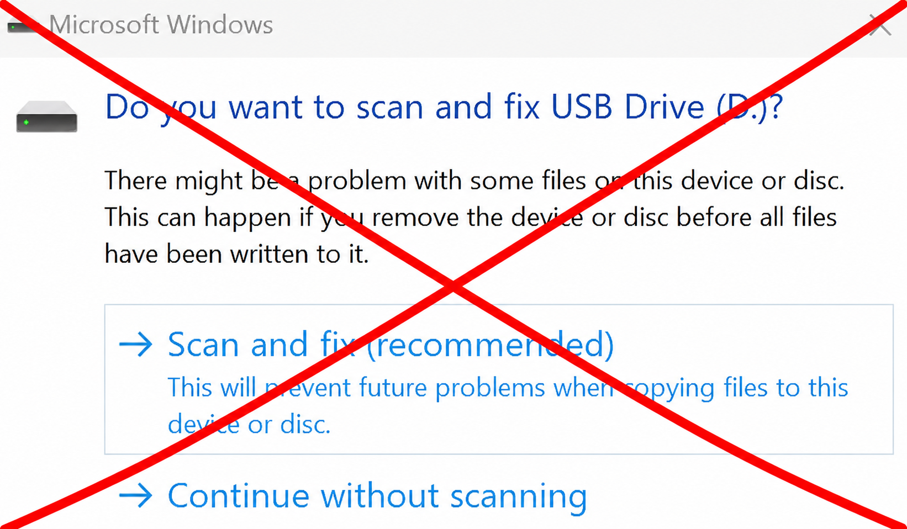

# Disable USB Scan and Fix Dialog Windows 11

**Keep AutoPlay. Skip unwanted disk repair prompts.**

[English](#english) · [Русский](#русский) · [Source code](disable-usb-scan-fix.wh.cpp) · [Windhawk submission #7943](https://github.com/ramensoftware/windhawk-mods/pull/7943)

---

## English

A lightweight [Windhawk](https://windhawk.net/) mod for Windows 11 that suppresses matching USB drive scan-and-repair notifications and prevents associated dialogs from opening through those notifications, without globally disabling AutoPlay.

### Features

| Feature | Behavior |
| --- | --- |
| Scan and Fix dialog | Prevents associated dialogs from opening through suppressed notifications |
| Disk repair notification | Suppresses matching disk warning toasts |
| Other notifications | Non-matching notifications are passed through |
| AutoPlay | The service remains enabled |
| Registry | No registry changes |
| Languages | Automatic localization using Windows resources; English/Russian fallback |

### Installation

The mod has been submitted to the official Windhawk catalog. Follow the [submission and review status](https://github.com/ramensoftware/windhawk-mods/pull/7943).

To try the source locally before catalog publication:

1. Install [Windhawk](https://windhawk.net/).
2. Open Settings and enable Developer Mode.
3. On the home page, select Create a New Mod.
4. Replace the example code with the complete contents of [disable-usb-scan-fix.wh.cpp](disable-usb-scan-fix.wh.cpp).
5. Compile the mod, enable it and exit editing mode.
6. Safely reconnect the USB drive to test the behavior.

To undo the change, disable the mod in Windhawk.

### Compatibility and implementation

- Target operating system: Windows 11.
- Tested on Windows 11 with Russian, German and French (Luxembourg) language settings, including after a restart. On the tested USB drive, the notification, associated dialog and unwanted automatic opening of File Explorer were suppressed. Other notifications continued to work.
- Automatically loads localized notification text from Windows system resources. No manual configuration is required.

> [!WARNING]
> This mod hides warnings. It does not repair filesystem errors, clear the dirty bit, or prevent data loss. Back up important files, eject removable drives safely, and check damaged drives manually when necessary.

---

## Русский

Модификация [Windhawk](https://windhawk.net/) для Windows 11, которая блокирует соответствующие уведомления о проверке USB-накопителей и предотвращает открытие связанных с ними окон без глобального отключения автозапуска.

### Возможности

| Функция | Действие |
| --- | --- |
| Окно проверки диска | Предотвращает открытие связанных окон через заблокированные уведомления |
| Уведомление о диске | Блокировка соответствующих предупреждений |
| Остальные уведомления | Не соответствующие фильтру уведомления пропускаются |
| Автозапуск | Служба остаётся включённой |
| Реестр | Без изменений |
| Языки | Автоматическая локализация через ресурсы Windows; русский и английский резервные шаблоны |

### Установка

Мод отправлен на публикацию в официальный каталог Windhawk: [Pull Request #7943](https://github.com/ramensoftware/windhawk-mods/pull/7943).

Для локальной установки из исходного кода:

1. Установите [Windhawk](https://windhawk.net/).
2. В параметрах включите режим разработчика.
3. На главной странице нажмите «Создать новую модификацию».
4. Замените шаблон полным содержимым файла [disable-usb-scan-fix.wh.cpp](disable-usb-scan-fix.wh.cpp).
5. Скомпилируйте и включите мод, выйдите из режима редактирования.
6. Безопасно переподключите USB-накопитель для проверки.

Для отмены изменений отключите мод в Windhawk.

### Совместимость

Проверено на Windows 11 с русскими, немецкими и французскими (Люксембург) языковыми настройками, в том числе после перезагрузки. На проверенном накопителе не появлялись предупреждение, связанное окно и нежелательное автоматическое открытие Проводника. Остальные уведомления продолжали работать. Ручная настройка не требуется.

> [!WARNING]
> Мод скрывает предупреждения, но не исправляет ошибки файловой системы, не сбрасывает признак Dirty Bit и не предотвращает потерю данных. Создавайте резервные копии важных файлов, безопасно извлекайте накопители и при необходимости проверяйте их вручную.

---

## Version history / История версий

| Version | Changes |
| --- | --- |
| 1.3 | Automatic notification localization using Windows resources; simplified code with no manual settings or detailed diagnostic logging |
| 1.2 | Retained hook implementation DLLs, restricted injection to Explorer and x86-64, improved DLL loading and typed hooks, added project homepage |
| 1.1 | Added selective AutoPlay notification filtering and English/Russian warning matching |
| 1.0 | Initial scan-and-fix dialog interception |

## Author / Автор

**[d-p4d-67](https://github.com/d-p4d-67)** · Developed with ChatGPT assistance / Разработано при помощи ChatGPT.

## License / Лицензия

[MIT License](LICENSE) © 2026 d-p4d-67.

Report issues: [GitHub Issues](https://github.com/d-p4d-67/Disable-USB-Scan-and-Fix-Dialog-Windows-11/issues).
